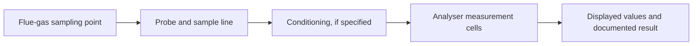

# Flue-Gas Analysis Fundamentals

A general learning guide to common combustion and flue-gas measurements. It is not manufacturer-specific documentation and does not replace the analyser manual, local regulations, or competent combustion-safety procedures.

## Typical parameters
| Parameter | Common unit | Why it matters | Important caveat |
|---|---|---|---|
| Oxygen (O₂) | % vol | Indicates residual oxygen and helps assess excess air | Depends on fuel, appliance, and test conditions |
| Carbon monoxide (CO) | ppm or mg/m³ | Indicates incomplete combustion and is safety-relevant | Follow instrument procedures and applicable limits |
| Carbon dioxide (CO₂) | % vol | Combustion/product-gas indicator | Check whether measured or calculated |
| Nitric oxide (NO) | ppm or mg/m³ | One component of NOx emissions | Sensor range and reporting basis matter |
| Nitrogen dioxide (NO₂) | ppm or mg/m³ | Relevant pollutant in some applications | Not every analyser measures NO₂ directly |
| Flue-gas temperature | °C | Used in combustion and heat-loss assessment | Probe placement and stabilisation affect readings |
| Ambient / combustion-air temperature | °C | Reference input for some calculations | Measure where the procedure specifies |
| Pressure / draught | Pa, hPa, or mbar | Indicates pressure difference or chimney draught | Confirm sign convention and connection method |

Parameters and sensor types vary by instrument. Verify exact capability in official model documentation.

## Conceptual sampling path

Follow the analyser instructions for filters, condensate traps, sample flow, warm-up, leak checks, calibration, and sensor protection. Not all instruments use the same sample-conditioning arrangement.

## Combustion concepts
- **Excess air:** air supplied beyond the theoretical amount required for combustion. Too little air can contribute to incomplete combustion; excessive air can increase stack heat losses.
- **Combustion efficiency:** an estimate based on defined inputs and a calculation method; it is not necessarily overall system efficiency.
- **O₂ / CO interpretation:** assess alongside fuel type, appliance design, operating load, sampling position, ambient conditions, and the applicable procedure.
- **Reference oxygen correction:** emissions may be reported corrected to a standard reference O₂ level. State the formula and reference basis; do not compare values with different bases directly.

## Safe workflow (high level)
1. Identify the analyser model and consult its current official manual.
2. Confirm appliance, fuel, operating condition, test location, and applicable procedure.
3. Inspect consumables and instrument status as directed by the manual.
4. Sample only at approved points and follow site safety controls.
5. Allow readings to stabilise as instructed; record units and conditions.
6. Interpret values using the applicable standard and competent guidance.
7. Complete post-use care and record faults or maintenance.

## Limitations
This repository explains general concepts only. It does not confirm specific ECOM model features, accuracy, sensor technology, service intervals, or regulatory compliance.

## References
- [U.S. EPA — Air emissions and monitoring resources](https://www.epa.gov/emc)
- [ECOM official website](https://www.ecom.de/)

**Status:** Educational reference. No analyser test or customer measurement is claimed.